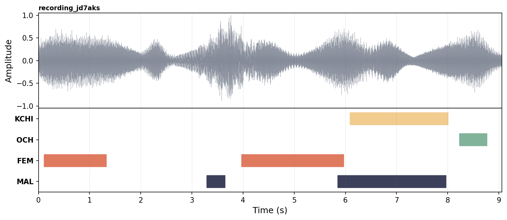

# User Guide

This page explains how to run VTC and read its output. The [Technical Reference](#technical-reference) lists every command-line option. Complete [Getting Started](getting-started.md) first.

---

## Run VTC

Put your `.wav` files in one folder and run the following command, replacing the paths in angle brackets with your own:

```bash
uv run vtc-infer             \
    --wavs <audio_folder>    \
    --output <output_folder> \
    --device cpu
```

VTC processes every `.wav` file in the folder. The first run downloads the model and needs an internet connection (see [Where the model comes from](getting-started.md#where-the-model-comes-from)).

To avoid retyping the command, edit the variables at the top of `run.sh`, at the root of the repository:

- `audios_path`: the folder containing your `.wav` files, e.g. `audios_path="/home/user/my_project/audio"`.
- `output`: the folder for the results, e.g. `output="/home/user/my_project/output"`. By default, each run writes to a new timestamped folder inside `out/`.

Then run:

```bash
sh run.sh
```

---

## Understanding the output

After a run, the output folder contains:

```
<output_folder>/
├── 📂 rttm/          # One .rttm file per audio recording
├── 📄 rttm.csv       # All detected segments combined into one CSV
└── 📄 f1.toml        # A copy of the thresholds used for this run
```

`rttm/` and `rttm.csv` contain the same results. Use the CSV for analysis: it opens in Excel, Numbers or LibreOffice and loads directly into R or Python. RTTM is a standard format in speech processing, and other tools such as ALICE expect it.

The `.toml` file records which [thresholds](advanced/thresholds.md) were used: `f1.toml` by default, `hp.toml` in high-precision mode, or your own file's name for [custom thresholds](advanced/thresholds.md#custom-threshold-files).

### What's in each row

Each row of the CSV, and each line of an RTTM file, is one detected speech segment:

| Field | Meaning |
|---|---|
| `uid` | The filename the segment came from. |
| `start_time_s` | When the segment starts, in seconds from the beginning of the recording. |
| `duration_s` | How long the segment lasts, in seconds. |
| `label` | The speaker category: `KCHI`, `OCH`, `MAL`, or `FEM`. |

For example, these rows from one recording correspond to the timeline below (the image is an illustration; VTC does not produce it):

```csv
uid,              start_time_s, duration_s, label
recording_jd7aks,         0.12,       1.20,   FEM
recording_jd7aks,         3.30,       0.34,   MAL
recording_jd7aks,         3.98,       1.98,   FEM
recording_jd7aks,         5.86,       2.10,   MAL
recording_jd7aks,         6.10,       1.90,  KCHI
recording_jd7aks,         8.24,       0.52,   OCH
```


Segments can overlap: here `MAL` and `FEM` overlap between 5.86 s and 5.96 s, and `MAL` and `KCHI` between 6.10 s and 7.96 s. VTC detects each category independently, so it can mark an adult and the child speaking at the same time.

??? note "RTTM format details"
    The `📂 rttm/` folder contains one RTTM file per audio file, one line per detected segment, in this layout:

    ```
    SPEAKER <uid> 1 <start_time_s> <duration_s> <NA> <NA> <label> <NA> <NA>
    ```

    The `1` and `<NA>` fields are required by the RTTM specification and are not used by VTC.

---

## How long will it take?

VTC is much faster on a GPU than on a CPU. The table shows measured processing times. The real-time factor is how many times faster than real time VTC runs: at 226×, one hour of audio takes about 16 seconds.

| Setup | Real-time factor | 1 h of audio | 16 h of audio |
|-------|---------|----------|-----------|
| H100 GPU, batch 256 | 226× | ~16 s | ~4 min |
| CPU (AMD EPYC 9334, 32 cores), batch 256 | 7× | ~8.5 min | ~2.3 h |

Use a GPU for large studies (hundreds of hours of recordings). If you don't have one, see [HPC / SLURM setup](advanced/hpc.md) for running VTC on a compute cluster.

!!! note "These numbers are approximate"
    Processing time also depends on the hardware, the length of the recordings, disk speed, the batch size and the sliding-window stride (`--stride_pct`, see [Command Line Interface Arguments](#command-line-interface-arguments)).

If VTC fails with `CUDA out of memory`, lower the batch size (see [Batch size and memory](#batch-size-and-memory)).

---

## Technical Reference

### Command Line Interface Arguments

Arguments accepted by `vtc-infer` (also listed by `uv run vtc-infer --help`):

| <div style="width: 180px;">Argument</div> | Default    | Description                                                        |
|-------------------------------------------|------------|--------------------------------------------------------------------|
| `--wavs`                                  | `data/debug/wav` | Folder containing the audio files. The default is a development folder, so always set this. |
| `--output`                                | **required** | Folder for the results. |
| `--device`                                | `cuda`     | `cuda`, `gpu` (same as `cuda`), `cpu` or `mps`. |
| `--batch_size`                            | `128`      | Batch size for the model's forward pass. |
| `--checkpoint`                            | `2.2`      | Model weights to use: a model version (`2.2` or `2.1`; for 2.0, see [Using VTC 2.0](misc/versions.md#using-vtc-20)), a local `.pt`/`.ckpt` file, or a folder containing one. |
| `--config`                                | `2.2`      | Model configuration to use: a model version, a local `config.toml` file, or a folder containing one. Must match `--checkpoint`. |
| `--thresholds-name`                       | `f1`       | Name of the thresholds file to use, without the `.toml` extension (e.g. `f1`, `hp`, or your own). |
| `--thresholds-location`                   | same as `--checkpoint` | Where to look for the thresholds file: a model version, a local `.toml` file, or a folder containing it. |
| `--high-precision`                        | `False`    | Use the high-precision thresholds (`hp`). Overrides `--thresholds-name`. |
| `--stride_pct`                            | `0.25`     | Step of the sliding window, as a fraction of the window length (`0.25` = 75% overlap, `0.5` = 50% overlap). Larger values are faster. |
| `--min_duration_on_s`                     | `0.1`      | Remove speech segments shorter than that many seconds.             |
| `--min_duration_off_s`                    | `0.1`      | Fill same-speaker gaps shorter than that many seconds.             |
| `--recursive_search`                      | `False`    | Also search subfolders of `--wavs`. Can be slow on large folders. |
| `--uris`                                  | —          | Text file listing the recordings to process, one file name per line (relative to `--wavs`, with or without `.wav`). Other files in `--wavs` are ignored. |
| `--keep_raw`                              | `False`    | Keep the raw RTTM files in `<output>/raw_rttm/` and write `<output>/raw_rttm.csv`. See [Raw model outputs](advanced/raw_outputs.md). |
| `--save_probs`                            | `False`    | Save the averaged per-frame probabilities to `<output>/probs/`. Can produce large files. |

!!! info "Model files are downloaded on demand"
    When `--checkpoint`, `--config` or `--thresholds-location` is a model version such as `2.2`, VTC downloads the files from the [`coml/VTC-2`](https://huggingface.co/coml/VTC-2) Hugging Face repository and caches them. Pass local paths instead to run a [fine-tuned](advanced/finetuning.md) model.

### Example commands

Process all `.wav` files in `my_audio/` on the CPU and write the results to `my_output/`:

```bash hl_lines="2 3"
uv run vtc-infer \
    --wavs my_audio/ \
    --output my_output/ \
    --device cpu
```

Use a smaller batch size on a GPU with limited memory:

```bash hl_lines="5"
uv run vtc-infer \
    --wavs my_audio/ \
    --output my_output/ \
    --device cuda \
    --batch_size 64
```

Include `.wav` files in subfolders, for example one folder per participant:

```bash hl_lines="5"
uv run vtc-infer \
    --wavs my_audio/ \
    --output my_output/ \
    --device cuda \
    --recursive_search
```

Use the high-precision thresholds, which give fewer false detections but miss more speech (see [Threshold selection](advanced/thresholds.md)):

```bash hl_lines="5"
uv run vtc-infer \
    --wavs my_audio/ \
    --output my_output/ \
    --device cuda \
    --high-precision
```

Also keep the RTTM files from before post-processing (see [Raw model outputs](advanced/raw_outputs.md)):

```bash hl_lines="5"
uv run vtc-infer \
    --wavs my_audio/ \
    --output my_output/ \
    --device cuda \
    --keep_raw
```

Drop segments shorter than 0.2 s and merge same-speaker segments separated by less than 0.15 s:

```bash hl_lines="5 6"
uv run vtc-infer \
    --wavs my_audio/ \
    --output my_output/ \
    --device cuda \
    --min_duration_on_s 0.2 \
    --min_duration_off_s 0.15
```

### Python API

`run_vtc` takes the same options as the command line, as keyword arguments: `--batch_size 64` becomes `batch_size=64`, `--high-precision` becomes `high_precision=True`, and `--thresholds-name` becomes `thresholds`.

```python
from vtc_inference import run_vtc

run_vtc(
    output="my_output/",
    wavs="my_audio/",
    config="2.2",
    checkpoint="2.2",
    device="cpu",
)
```

!!! warning "Always set `config`, `checkpoint` and `device` from Python"
    In Python, `config` and `checkpoint` default to `2.1` and `device` to `gpu`, unlike the command line.

### Batch size and memory

Larger batches are faster but use more GPU memory. Suggested starting points: `256` for an H100 or A100, `128` (the default) for an A40 or RTX 3090, `64` for an RTX 3060 or other 12 GB cards, and `32` or lower on CPU. Lower the batch size if you get `CUDA out of memory`. `--batch_size` sets the number of audio windows per forward pass, not the number of files processed in parallel.

<!-- ### Post-processing defaults

Predictions are post-processed before being written out:

1. Per-class binarization using thresholds from `f1.toml` (default) or `hp.toml` (with `--high-precision`). See [Threshold selection](advanced/thresholds.md).
2. Removal of segments shorter than `--min_duration_on_s` seconds.
3. Merging of same-class segments separated by less than `--min_duration_off_s` seconds.

To inspect the model's pre-post-processing output, pass `--keep_raw`; the pre-binarization frame-level scores can be dumped with `--save_probs`. -->

<!-- ## test

<iframe
  src="/assets/visualisations/audio-annotations-player.html"
  width="100%" height="760"
  style="border:1px solid var(--md-default-fg-color--lightest);border-radius:8px"
  loading="lazy"></iframe> -->
